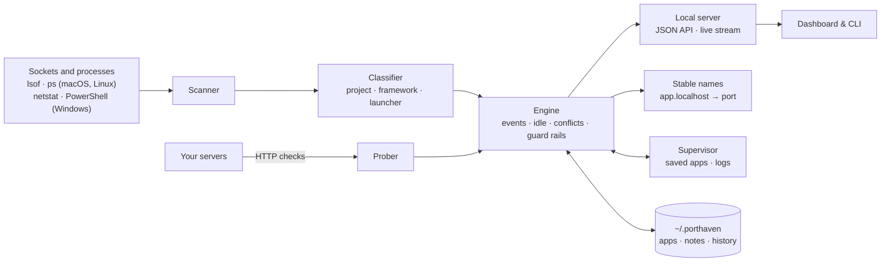

<div align="center">


# Porthaven

**A safe haven for every port on your machine.**

See every app listening on a port: what it is, which project it belongs to, whether it answers.
Start whole stacks in dependency order, give each git branch its own port, and let your coding agent do the same.

[](https://github.com/KirtiJha/porthaven/actions/workflows/ci.yml)
[](LICENSE)


</div>

## Why

Every project brings a dev server, an API, a database and a watcher. They pile up on ports you never chose:

- `EADDRINUSE` on :5173, and then `lsof`, a pid and `ps` just to find out what holds it.
- Vite and Next quietly move to the next free port, so your bookmark now opens a different project.
- `kill <pid>` hits a child process, and `make dev` starts it again.
- A server bound to `0.0.0.0` is reachable from the café Wi-Fi. Last week's prototype is still holding 400 MB.
- Two branches, or two coding agents, both want :3000. The frontend has the API's port hard-coded.

Porthaven turns that into one live, searchable dashboard, with a command line for when you are already in a terminal
and an MCP server for when your coding agent is the one starting servers.

## Quick start

You need Python 3.9 or newer. Node 20+ is needed only once, to build the UI.

**macOS / Linux**

```bash
git clone https://github.com/KirtiJha/porthaven.git && cd porthaven
make run          # builds the UI the first time, starts Porthaven, opens http://localhost:7475
make install      # optional: a `porthaven` command on your PATH (~/.local/bin)
```

**Windows (PowerShell)**

```powershell
git clone https://github.com/KirtiJha/porthaven.git; cd porthaven
cd web; npm install; npm run build; cd ..
bin\porthaven.cmd    # starts Porthaven and opens http://localhost:7475
```

The tour of every feature is at http://localhost:7475/welcome.

## Features


### See
- **Live port map.** Every listening TCP port, refreshed every two seconds and grouped by project. Each row shows:
  - the framework (Vite, Next, Uvicorn, Django, Postgres…) and the page title;
  - HTTP status and response time, uptime, connections, and CPU and memory sparklines.
- **Network warnings** for anything reachable from other devices, with the Wi-Fi URL for phone testing.
- **Forgotten servers.** Dev servers with no connections and no CPU for hours are flagged, with the memory
  they hold.
- **Search, filters and pins.** Search on port, project, command and notes; `:51` finds ports starting with 51.
- **Docker-aware.** Published container ports show the container and image.

### Act
- **Stop the whole app, not just the pid.** Porthaven walks up from the port's process through launchers
  (`make`, `npm`, shells, reloaders) and stops the whole tree. It stops at your terminal, editor or agent.
- **Graceful first.** SIGTERM (or `taskkill`) first; force only after a grace period you choose.
- **Bulk stop** of several ports or apps, and a one-click clean-up of idle servers.
- **Guard rails.** No sudo, ever. Porthaven won't stop itself, other users' processes, or anything it doesn't show.
  System services and desktop apps need you to type the port number to confirm.

### Run
- **Saved apps.** Save a command, folder and port once, then start, stop and restart with one click.
  - Output is live and coloured, with clickable URLs and a jump to error lines.
  - Groups start and stop together, and crashed apps can restart automatically.
- **Port conflicts handled before they happen.** See who holds the port, then take the next free one
  (Porthaven sets `PORT` and fills `{port}` in the command) or take the port over.
- **Stable names.** `http://shop.localhost:7475` reaches the app on whatever port it is on today, websockets and
  hot reload included.
- **Outlives restarts.** Apps keep running when Porthaven stops or restarts, and Porthaven picks them up again.
- **Find projects.** Porthaven scans a folder for npm, pnpm and yarn scripts, Makefile targets, Django, FastAPI,
  Flask and Streamlit apps, and Compose files.
- **Sleep when quiet.** An app with no traffic for the time you choose is stopped to free its memory, and the next
  request to its stable name starts it again.
- **Workspaces.** Save what is running ("Shop, full stack"), then restore it later in one click, or switch to it and
  stop everything else.

### Stacks


- **Dependencies.** "Storefront starts after Shop API": Porthaven starts the API first and waits for its health
  check (`/health`, or just the port) before starting what needs it. Cycles and missing apps are reported up front.
- **Apps find each other.** Write `{url:api}` or `{port:api}` in a command or environment variable, and Porthaven
  fills in the port the API is on today. Every app also gets `PORTHAVEN_<APP>_PORT` and `PORTHAVEN_<APP>_URL`.
- **`porthaven.toml`.** Commit the stack to the repo; whoever clones it runs `porthaven up`. Two apps from different
  folders that expect the same port are flagged before they collide.

```toml
group = "Shop"

[apps.api]
command = ".venv/bin/uvicorn main:app --reload --port {port}"
cwd = "backend"
port = 8000
health = "/health"

[apps.web]
name = "Storefront"
command = "npm run dev -- --port {port} --strictPort"
cwd = "frontend"
port = 5173
depends_on = ["api"]
env = { VITE_API_URL = "{url:api}" }
sleep_after = 60
```

- **Git worktrees.** Run any saved app from another worktree of its repo. It gets its own port and its own address
  (`http://feature-x.api.localhost:7475`), so parallel branches, and parallel coding agents, stop fighting over one
  port. Cards show the branch each app runs from.

### For coding agents


Porthaven includes an [MCP](https://modelcontextprotocol.io) server, so Claude Code, Cursor, Windsurf and other agents
can see ports, start stacks, read logs and free ports with the same guard rails you have.

```bash
claude mcp add porthaven -- porthaven mcp
```

For Cursor, Windsurf and other clients, add this to their MCP settings (Settings → Connect a coding agent shows the
full path for your machine):

```json
{ "mcpServers": { "porthaven": { "command": "porthaven", "args": ["mcp"] } } }
```

Tools: `list_ports`, `port_info`, `list_apps`, `start_app`, `stop_app`, `restart_app`, `app_logs`, `stop_port`,
`find_free_ports`, `stack_up`, `stack_down`, `run_in_worktree`, `recent_requests`, `recent_activity`. The agent
starts Porthaven if it isn't running, and its actions show in Activity as "by agent".

### Understand
- **Activity timeline.** One lane per port, with markers for launches, crashes and conflicts, plus a
  weekday-by-hour heatmap and an event log.
- **Insights.** A week of history:
  - memory by project, and ports over time;
  - health (checks OK, average and p95 response time);
  - top-five lists, and suggestions with one-click fixes.
- **Request inspector.** Every request through an app's stable name is recorded: method, path, status, time and
  size, with a filter, in the app's Requests tab.
- **Exposure guard.** A Werkzeug debug console or Django debug pages reachable from the network are flagged as
  critical or high, with a notification and the fix.
- **Watch and notify.** A banner, a toast and a desktop notification when a watched port goes down.
- **Install as an app.** Porthaven installs as its own window with a dock badge (Settings → Install as an app), and
  [a menu-bar plugin](extras/menubar) for SwiftBar, xbar and Argos shows your ports at a glance.

### Keyboard

| Keys | Action | Keys | Action |
|---|---|---|---|
| `⌘K` / `Ctrl K` | Command palette (type a port number) | `o` | Open in browser |
| `/` | Search | `c` | Copy URL |
| `1`–`4` | Ports · Apps · Activity · Insights | `p` / `w` | Pin / watch |
| `j` `k` | Move between rows | `x` / `⇧X` | Stop process / whole app |
| `Space` | Select for bulk stop | `?` | All shortcuts |

## Command line

```bash
porthaven                  # the dashboard (same as `porthaven serve`)
porthaven ls [--all]       # listening ports; --json for scripts
porthaven who 5173         # what is on a port: command, folder, app, HTTP answer
porthaven kill 5173 --app  # stop the whole app on a port (asks first; -y to skip)
porthaven free 3000 -n 5   # the next free ports
porthaven open 5173        # open in the browser
porthaven up               # start the apps in ./porthaven.toml, dependencies first
porthaven down             # stop them
porthaven init             # write a porthaven.toml from the saved apps in this folder
porthaven start shop       # start a saved app and its dependencies; `porthaven stop shop`
porthaven mcp              # MCP server (stdio) for coding agents
porthaven service install  # start at login (launchd, systemd or Task Scheduler); uninstall / status
```

The commands that change things talk to the running dashboard and start it if needed.

## How it works




A small local server reads the machine every two seconds (about 0.2 s of work on macOS). It works out what each
listening process is and which app launched it, asks each web server for its status and title, and streams the
picture to your browser. Everything is the Python standard library, plus the tools your OS already has.

## Security

- **Loopback only.** Porthaven listens on `127.0.0.1` and `::1`, never on your network.
- **DNS rebinding blocked.** It answers only requests addressed to its own `localhost` port.
- **Session token.** Every change needs a per-session token that only Porthaven's own page can read.
- **Same rules for agents.** The MCP server uses the same guard rails: it won't stop Porthaven itself, other users'
  processes, desktop apps or system services.
- **No sudo, no telemetry.** State lives in `~/.porthaven` (move it with `PORTHAVEN_HOME`).

See [SECURITY.md](SECURITY.md) for how to report a vulnerability.

## Platform notes

| | macOS | Linux | Windows |
|---|---|---|---|
| Reads ports and processes with | `lsof`, `ps` | `/proc`, `ps` | `netstat`, PowerShell |
| Stops processes with | signals | signals | `taskkill` |
| Knows each process's folder | ✓ | ✓ | from its command line |
| Start at login | launchd | systemd user service | Task Scheduler |

## Contributing

Issues and pull requests are welcome. [CONTRIBUTING.md](CONTRIBUTING.md) covers setup, tests and the project layout.
`make test` runs the backend tests (a real server and a real app included) and the UI type check. CI runs them on
macOS, Linux and Windows.

## License

[MIT](LICENSE) © Kirti Nath Jha
